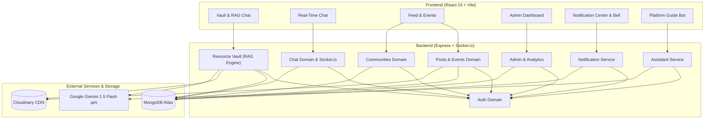

# Codebase Map — CampusGrid

## Stack

- **Backend Language & Runtime:** Node.js (CommonJS, `require`)
- **Backend Framework:** Express `^5.2.1`, HTTP Server with Socket.io `^4.8.3`
- **Database & ORM:** MongoDB Atlas via Mongoose `^9.4.1`
- **Frontend Framework & Tooling:** React `^19.2.4`, Vite `^8.0.4` (ES Modules)
- **Styling:** Tailwind CSS `^4.2.2` via `@tailwindcss/vite`
- **File Storage:** Cloudinary (`cloudinary` `^1.41.3`, `multer-storage-cloudinary` `^4.0.0`) + Multer `^2.1.1`
- **AI & RAG Engine:** Dual-Engine (Google Gemini 1.5 Flash via `@google/generative-ai` / fetch API + Local Rule-based Synthesizer), PDF chunk extraction via `pdf-parse` `^2.4.5`
- **Authentication:** JWT (`jsonwebtoken` `^9.0.3`), Passwords hashed via `bcryptjs` `^3.0.3`

---

## Domains

| Domain | Location | Purpose | Depends on | Depended on by |
| :--- | :--- | :--- | :--- | :--- |
| **Auth** | `backend/routes/authRoutes.js` `backend/controllers/authController.js` `backend/models/User.js` | User registration, login, JWT token issuance, auth validation | Database (`User` model), bcryptjs, jsonwebtoken | API Routes (`authMiddleware`), Socket.io Auth, Frontend Auth Context |
| **User & Profile** | `backend/routes/userRoutes.js` `backend/controllers/userController.js` `backend/middlewares/uploadMiddleware.js` | User profiles, avatar uploads, skill tags, user listings | Auth, Database (`User`), Cloudinary, Multer | Frontend Profile Page, Community Memberships, Posts, Chat |
| **Resource Vault (RAG)** | `backend/routes/hubRoutes.js` `backend/controllers/hubController.js` `backend/utils/pdfProcessor.js` `backend/utils/ragSynthesizer.js` `backend/models/Resource.js` | PDF uploads, text chunking, passage similarity search, Gemini AI / local synthesis, PDF Chat | Database (`Resource`), Auth, Cloudinary, pdf-parse, Gemini API | Frontend Vault Page (`/vault`), Document Chat (`/vault/chat/:id`), Admin moderation |
| **Communities** | `backend/routes/communityRoutes.js` `backend/controllers/communityController.js` `backend/models/Community.js` `backend/models/CommunityMembership.js` | Campus communities, membership requests, role approvals, join/leave | Auth, Database (`Community`, `CommunityMembership`, `User`) | Frontend Communities Page, User Profiles |
| **Posts & Feed** | `backend/routes/postRoutes.js` `backend/controllers/postController.js` `backend/models/Post.js` | Social feed, post creation, media attachments, likes, comments | Auth, Database (`Post`, `User`), Cloudinary | Frontend Main Feed, User Profiles |
| **Events** | `backend/routes/eventRoutes.js` `backend/controllers/eventController.js` `backend/models/Event.js` | Campus event publishing, RSVPs, registration lists | Auth, Database (`Event`, `User`), Cloudinary | Frontend Events Page |
| **Real-Time Chat** | `backend/routes/chatRoutes.js` `backend/controllers/chatController.js` `backend/socket.js` `backend/models/Conversation.js` `backend/models/Message.js` | Direct & group student messaging, real-time typing indicators, read receipts | Auth, Socket.io, Database (`Conversation`, `Message`, `User`) | Frontend Chat Workspace |
| **Content & Engagement** | `backend/routes/contentRoutes.js` `backend/controllers/contentController.js` `backend/models/Poll.js` `backend/models/Survey.js` `backend/models/Job.js` `backend/models/Request.js` | Campus polls, surveys, peer help requests, job board | Auth, Database (`Poll`, `Survey`, `Job`, `Request`, `PollVote`, `SurveySubmission`) | Frontend Hub / Dashboard Widgets |
| **Notifications** | `backend/routes/notificationRoutes.js` `backend/controllers/notificationController.js` `backend/services/notificationService.js` `backend/models/Notification.js` | Real-time & in-app alerts, category filtering, user preferences, socket dispatch | Auth, Socket.io, Database (`Notification`, `User`) | Frontend NotificationBell, Dropdown, Notifications Page (`/hub/notifications`) |
| **Platform Assistant** | `backend/routes/assistantRoutes.js` `backend/controllers/assistantController.js` | Interactive platform guide, FAQ intent matcher, navigation assistance, Gemini fallback | Auth, Gemini API | Frontend PlatformAssistant floating widget (`DashboardLayout`) |
| **Admin & Analytics** | `backend/routes/adminAnalyticsRoutes.js` `backend/controllers/adminAnalyticsController.js` `backend/controllers/adminController.js` `backend/models/Report.js` | Platform stats, user management, content moderation, reports | Auth, Database (`Report`, `User`, `Resource`, `Post`, `Community`) | Frontend Admin Dashboard |

---

## Dependency Graph

---

## Scale & Performance Profile

- **Current Load Sizing Target:** ~1,000 to 5,000 active campus users (~50–100 req/sec peak), read-heavy (~85% reads / 15% writes).
- **RAG Engine Overhead:** 
  - Text chunks stored as embedded array `resource.chunks` in MongoDB.
  - Chunk size: 1,200 chars (~1.2 KB) with 150-char overlap. 1,000 PDFs consume ~14 MB MongoDB storage.
  - Document-scoped RAG queries scan strictly 1 document (~15 KB payload) yielding <30ms response times.
- **Bottlenecks & Scale Ceilings:**
  - *In-Memory Socket Map:* Socket connections tracked in `activeUsers` Map in `backend/socket.js`. Requires Redis adapter (`@socket.io/redis-adapter`) if horizontal scale exceeds 1 server instance.
  - *Vector Search Ceiling:* Embedded array search scales well up to ~5,000 PDFs. Beyond 10,000+ PDFs, offload vector indexing to MongoDB Atlas Vector Search or Pinecone.
  - *File Uploads:* PDF uploads stream through Cloudinary middleware with strict 15MB limit to prevent blocking Node event loop.

---

## Code Base Pattern Conventions

- **Module Format:** CommonJS (`require`/`module.exports`) in `backend`, ES Modules (`import`/`export`) in `frontend`.
- **Controller Pattern:** Async functions wrapping Mongoose queries returning JSON responses: `{ success: true, data }` or `{ message }` with HTTP status codes (`200`, `201`, `400`, `401`, `403`, `404`, `500`).
- **Route Registration:** Modular routes in `backend/routes/` mounted in `backend/server.js` under `/api/<domain>` prefixes.
- **Error Handling:** Explicit `try/catch` blocks in controllers and a centralized Express error middleware in `server.js` for file size limits and unhandled errors.
- **Authentication Pattern:** JWT passed in HTTP `Authorization: Bearer <token>` header or Socket handshake `auth.token`. Standard `protect` and `adminOnly` middlewares.

---

## Quick Start by Role

- **Frontend Contributor:** Inspect `frontend/src/pages` and `frontend/src/components`. Check corresponding backend API contracts before modifying fetch/axios logic.
- **Backend/API Contributor:** Inspect the target controller in `backend/controllers/` and route in `backend/routes/`. Review "Depended on by" before updating response schemas or route parameters.
- **Database/Schema Changes:** Check `backend/models/` and trace downstream controller usages for that Mongoose schema.

---

## Before You Change Something

1. Locate your domain in the **Domains Table**.
2. Review the **Depended on by** column — those components require regression testing if public interfaces change.
3. Keep this `CODEBASE.md` map updated whenever adding, removing, or refactoring domain boundaries or public API contracts.
